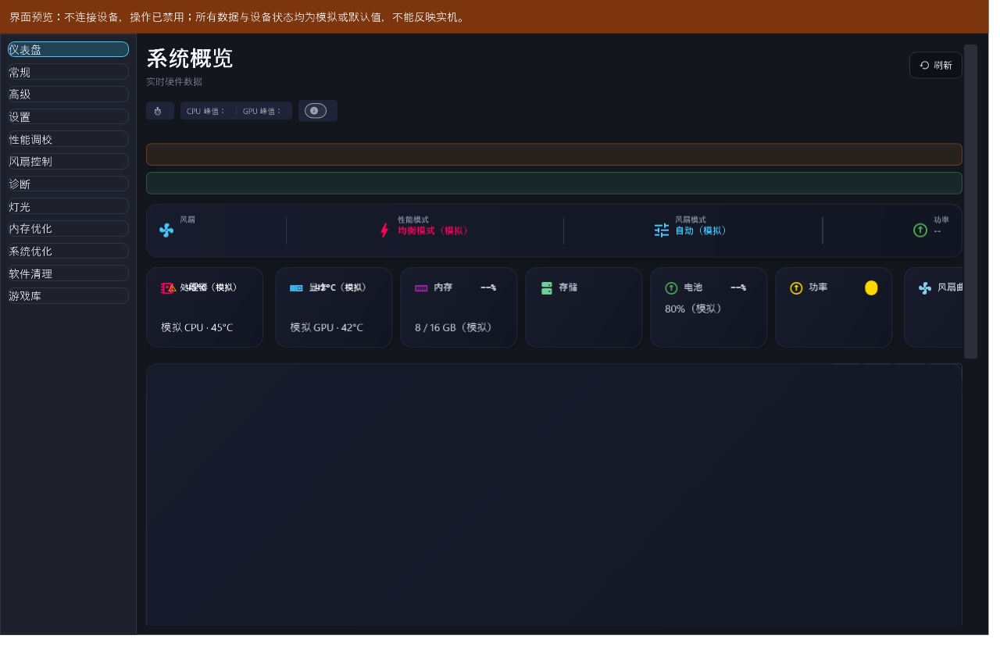
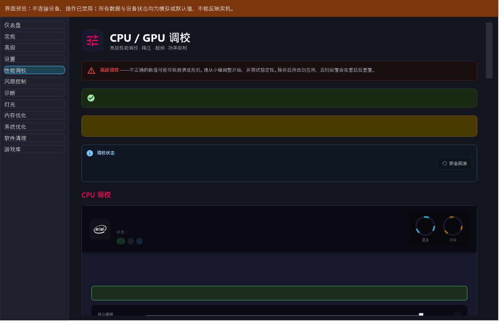

  

  # OmenCore 简体中文版

  **让熟悉的硬件控制界面，更容易读懂。**

  基于 OmenCore v5.0.1 的非官方简体中文本地化版本

  `Windows 11 x64`　·　`简体中文 / English / Русский / Türkçe`　·　`MIT License`

  [下载中文版](https://github.com/Masterossss/OmenCore-zh-CN/releases/tag/v5.0.1-zh-CN)　 |　 [安装与使用](#开始使用)　 |　 [已知问题](#已知问题)　 |　 [上游项目](https://github.com/theantipopau/omencore)

---

## 关于这个版本

OmenCore 为 HP OMEN 和 Victus 设备提供本地硬件监控及控制功能。本仓库以官方 **v5.0.1** 为基础，面向简体中文用户整理界面文字、操作反馈和风险提示，同时保留其他语言选项。

这是**社区维护的非官方本地化版本**，与上游官方发行版有区别。设备支持情况取决于具体型号、固件和驱动，功能可用性可能有所不同。

## 下载中文版

前往 **[v5.0.1 简体中文版下载页面](https://github.com/Masterossss/OmenCore-zh-CN/releases/tag/v5.0.1-zh-CN)**，在 **Assets** 中选择：

| 文件 | 用途 |
| --- | --- |
| `OmenCore-5.0.1-zh-CN-win-x64.zip` | Windows x64 便携程序，解压后运行 |
| `SHA256SUMS-OmenCore-5.0.1-zh-CN.txt` | 下载文件的 SHA256 校验值 |

> GitHub 自动生成的 `Source code` 文件是源码，不是便携程序。当前提供 ZIP 便携版，尚未提供中文安装向导。

## 开始使用

1. 下载并解压中文版 ZIP 到独立目录，避免覆盖现有安装。
2. 打开解压后的目录，运行 `OmenCore.exe`。
3. 如果界面未显示中文，在 **Settings / 设置** 中选择 **简体中文**，并按提示重启程序。

程序为 Windows x64 自包含构建，无需单独安装 .NET 运行时。风扇、功率和其他设备控制功能的可用性取决于硬件及所需驱动。

## 界面预览

以下截图来自独立 WPF 展示宿主：**使用模拟或默认数据，操作控件已禁用**。它们用于展示界面文字和布局，不代表真实设备状态。

查看仪表盘预览

查看性能调校预览

## 中文版包含什么

- 主要导航、设置、监控、灯光、性能调校等界面的简体中文资源。
- 风扇、CPU/GPU 功率及温度相关的部分警告和动态反馈。
- English、Русский、Türkçe、简体中文及系统默认语言选项。
- 对未知后端消息保留原文，避免误判操作结果。

## 已知问题

- 部分设备状态、图表、低频提示及未知后端错误可能仍显示英文。
- 原版风扇校准的“清除数据”功能未实际删除数据；本版本已修正提示，功能本身仍未实现。
- 用户报告已手动检查生产运行安全和硬件兼容性；未提供具体机型和逐项测试记录。不同机型及全部功能场景未因此得到全面验证。

详细信息见 [已知问题](KNOWN-ISSUES-ZH-CN.md) 和 [GUI 测试记录](GUI-TEST-REPORT.md)。使用性能调校或风扇控制功能前，请阅读程序内的警告并确认设备支持情况。

## 源码与反馈

- 中文版源码：本仓库的 `main` 分支。
- 中文版发布记录：[Releases](https://github.com/Masterossss/OmenCore-zh-CN/releases)。
- 上游原版：[theantipopau/omencore](https://github.com/theantipopau/omencore)。
- 上游英文介绍：[README.upstream.md](README.upstream.md)。
- 问题反馈：[提交 Issue](https://github.com/Masterossss/OmenCore-zh-CN/issues)。

## 许可与致谢

感谢 OmenCore 上游作者和贡献者。本仓库保留上游的 [MIT 许可证](LICENSE) 以及 [第三方组件声明](THIRD-PARTY-NOTICES.md)。
